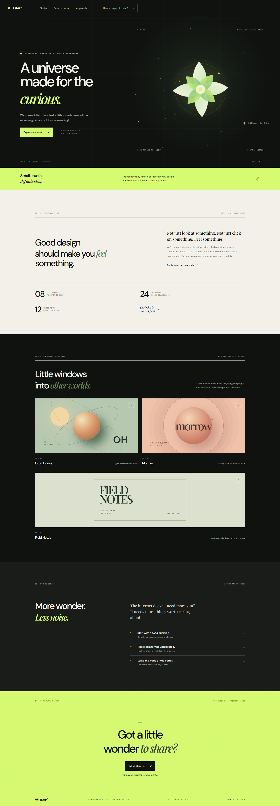

# Aster Studio — Digital worlds for curious people

A polished, responsive landing page for an independent creative studio, with a sculptural bloom and drifting starlight rendered with Three.js.

## Preview



## Run locally

Serve this directory over HTTP so the browser can load the JavaScript module and Three.js import map. For example, with Python installed:

```bash
python -m http.server 8000
```

Then open [http://localhost:8000](http://localhost:8000). An internet connection is needed to load the Three.js module and Google Fonts.

## Files

- `index.html` — Page structure, metadata, and Three.js module import map.
- `style.css` — Responsive layout, typography, and project artwork.
- `main.js` — Three.js starlight scene, subtle animation, and pointer interaction. The SVG bloom stays consistent across browsers, even if WebGL or the Three.js CDN is unavailable.
- `screenshot.png` — Full-page preview.

## Interaction

Move your pointer over the bloom to gently tilt it. Navigation links scroll to page sections; the contact buttons open an email draft. The animated scene respects reduced-motion preferences.
